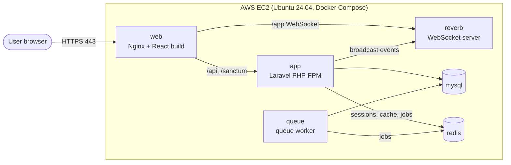

# Hamro Astro

A real-time astrology consultation chat application. Customers chat with an astrologer (admin) over WebSockets, with live typing indicators, online status, and per-message payment tracking. Built as a full-stack project and deployed end to end by one developer: application code, containers, and cloud infrastructure.

## Features

- Real-time one-to-one chat between customers and an admin, powered by WebSockets (Laravel Reverb + Laravel Echo)
- Typing indicators, online/offline status, and read receipts
- Message types (normal, question, answer) and per-message payment status
- Free-message limits per user
- User profiles with birth details and rashi (moon sign)
- Token-based authentication (Laravel Sanctum) with customer and admin roles
- Mobile-aware reconnection logic for unstable connections

## Tech stack

| Layer | Technology |
|---|---|
| Frontend | React 19, React Router, Tailwind CSS, Axios, Laravel Echo |
| Backend | Laravel 12 (PHP 8.3), Laravel Sanctum, Laravel Reverb |
| Database | MySQL 8 |
| Cache, sessions, queues | Redis |
| Web server | Nginx (static files, API proxy, WebSocket proxy, TLS) |
| Containers | Docker, Docker Compose |
| Cloud | AWS EC2 (Ubuntu 24.04), Let's Encrypt HTTPS |

## Architecture



All traffic enters through one Nginx container on ports 80 and 443:

- `/` serves the compiled React app
- `/api` and `/sanctum` are passed to Laravel (PHP-FPM)
- `/app` is proxied to the Reverb WebSocket server

Docker Compose runs six containers: `web` (Nginx + React build), `app` (Laravel PHP-FPM), `reverb` (WebSocket server), `queue` (queue worker), `mysql`, and `redis`. The Laravel image is built once and reused for the `app`, `reverb`, and `queue` services.

## Deployment notes

- **Multi-stage builds:** the React app is compiled in a Node image, and only the static files are copied into a small Nginx image.
- **Secrets stay out of Git:** database passwords, the app key, and the Reverb credentials live in `.env` files created on the server, and are excluded from images with `.dockerignore`.
- **HTTPS:** a Let's Encrypt certificate is mounted into the Nginx container, and plain HTTP is redirected to HTTPS.
- **Data persistence:** MySQL data, Redis data, and Laravel storage use named Docker volumes.
- **Health checks:** MySQL has a health check, and dependent containers wait for it before starting.
- **Small-server tuning:** deployed on a 2 GB EC2 instance with swap space, and build caches cleaned between builds.

## Run it yourself

Requirements: Docker and Docker Compose, and a domain with a TLS certificate if you want HTTPS.

1. Clone the repository:
   ```bash
   git clone https://github.com/suvkshyaa/hamroastro.git
   cd hamroastro
   ```
2. Create `.env` in the project root with your database settings and a Reverb key:
   ```
   MYSQL_ROOT_PASSWORD=change-me
   DB_DATABASE=hamroastro
   DB_USERNAME=hamroastro_user
   DB_PASSWORD=change-me-too
   REACT_APP_REVERB_APP_KEY=choose-a-random-key
   ```
3. Copy `backend/.env.example` to `backend/.env` and fill it in. Use `DB_CONNECTION=mysql`, `DB_HOST=mysql`, `REDIS_HOST=redis`, set the same Reverb key, and generate an app key with `php artisan key:generate --show`.
4. In `docker-compose.yml` and `frontend/nginx.conf`, replace `aws.hamroastro.com` with your own domain.
5. Build and start everything:
   ```bash
   docker compose up -d --build
   docker compose exec app php artisan migrate --force
   ```

## Project structure

```
backend/     Laravel API, broadcasting channels, migrations, Dockerfile
frontend/    React app, Nginx config, Dockerfile
docker-compose.yml
```